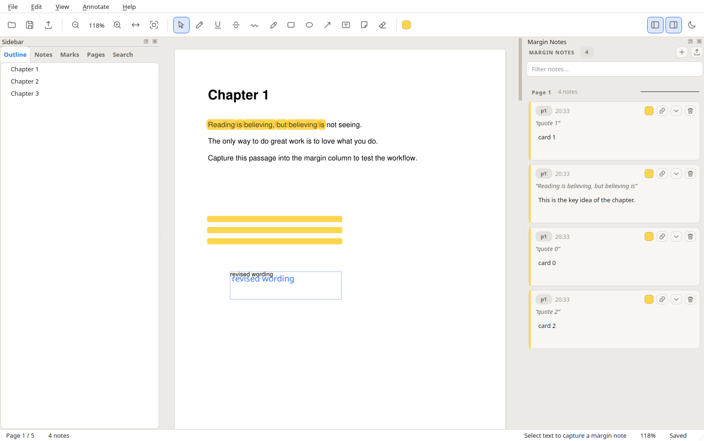
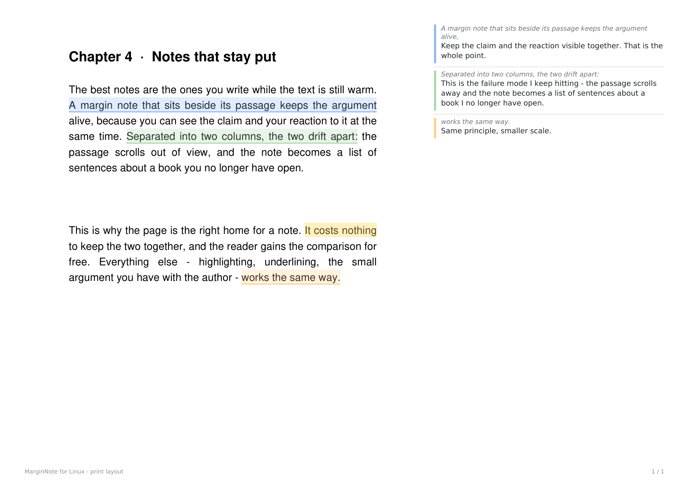

# ahaMargin-linux

A **MarginNote style PDF marker** for Linux: select a passage in a document and
it is captured into a note card in the margin column, where the quoted text
stays attached to your own thoughts. Mark up the page with highlights, ink and
shapes, then export the result as an annotated PDF, a study sheet or a mind map.

Built with **PySide6 (Qt 6)** and **PyMuPDF**. This is an independent
implementation and is not affiliated with MarginNote or its authors.



*The margin column on the right holds the notes; each one keeps the quoted
passage attached and carries its own colour back into the document.*

---

## Features

### The margin note column (the core idea)

* **Capture on select** — drag across any text and a note card appears in the
  right hand column with the quoted passage attached. The caret lands in the
  card so you can type straight away.
* **Two-way linking** — click the quote to jump to the passage in the document;
  click an annotation in the document to highlight its card.
* **Colour tags** — every card carries a colour; the colour follows the note
  back into the document, so related passages stay visually grouped.
* **Collapsible cards** — fold a card down to its quote and a one line preview.
* **Grouped by page** — cards are ordered by page and position, and you can
  **drag a card header to reorder it** within its page group.
* **Filter** — narrow the column down with a search box once you have more
  notes than fit on screen.

### Marking tools

Highlight, underline, strikethrough, squiggly, freehand pen, rectangle,
ellipse, arrow, line, text box, sticky note and an eraser. Each tool has its
own colour; the marking colour is picked from the toolbar.

Marks can be edited in place on the canvas: **click** one to select it,
**double click** a text box or sticky note to rewrite its wording, and
**Delete** removes the selected mark.

### The document

* Continuous vertical scrolling, fit-width / fit-page / actual size, and
  Ctrl+wheel zooming.
* Rotated pages are handled correctly: text selection, highlighting and
  anchoring all follow the page as it is displayed.
* **Outline** panel for the PDF bookmarks.
* **Notes** panel: a tree of every margin note, grouped by page.
* **Marks** panel: *every* annotation, marked with its colour. Right click a
  row to jump to it, **change its colour**, **turn it into a margin note**
  (which quotes the text it covers) or delete it.
* **Pages** panel: lazily rendered page thumbnails.
* **Search** panel: full text search across the whole document with context.
  Selecting a result scrolls to the exact hit and flashes it, and jumping to a
  note flashes its passage in the document.

### Export

| Format | What you get |
| --- | --- |
| **Annotated PDF** (`Ctrl+E`) | A copy of the document that keeps the annotations as real PDF annotations. |
| **Flattened PDF** | The marks burned into the page content — no annotation objects left. Ideal for printing or for tools that ignore annotations. |
| **Print layout** (`Ctrl+P`) | The document on the left of each sheet, your margin notes set in the margin beside the passages they belong to. |
| **Markdown** | A study sheet: quotes and notes grouped by page. |
| **JSON** | Every annotation with its full geometry, colour and timestamps. |
| **CSV** | One row per annotation, for spreadsheets. |
| **Mind map (SVG)** | A vector tree of document → page → note. |
| **Notes as PDF outline** | A copy of the document whose bookmarks mirror your margin notes, so your annotations become a navigable table of contents. |

### Printing with margin notes

The core idea behind ahaMargin is simple: a note belongs **next to** the
passage it talks about, so that is how it prints.



*The document on the left, the notes in the margin on the right — each note
carries the colour it has in the app, and the anchor on the page points back at
the passage it belongs to.*

**File → Print with margin notes…** opens a dialog with a small preview of the
sheet, then the system print dialog. Each source page is placed on the left of a
sheet and the margin notes that belong to it are typeset in a column on the
right — the quoted passage in italics above your own words, each note carrying
the colour it has in the app.

* The **page content stays vector**, so the text of the original document is
  still selectable and searchable in the printed result.
* Notes that do not fit on the first sheet of a page **continue on the next
  sheet**, so nothing is ever silently dropped.
* Paper size, orientation, the width of the note column, the text size, a page
  range (`1-5, 9`) and whether to repeat the quotes are all configurable, and
  the last choice is remembered.
* **File → Export print layout PDF…** writes the same layout to a file without
  going near a printer — useful for archiving or for a mail attachment.

### Everything else

* Undo / redo across every change, including the text you type into a note
  (a burst of typing counts as one step).
* Light and dark themes.
* **Focus mode** (`F11`) hides the toolbars and panels so the document can be
  read undisturbed.
* Full keyboard workflow, and a list of recent documents.
* Annotations are stored **inside the PDF**, so a marked-up document stays a
  single portable file.

---

## Install

### 1. System libraries

Qt needs a handful of X11 libraries to open a window:

```bash
sudo ./scripts/install-deps.sh
```

<details>
<summary>Manual package lists</summary>

Debian / Ubuntu / Mint:

```bash
sudo apt-get install -y libgl1 libegl1 libxkbcommon-x11-0 libxcb-cursor0 \
    libxcb-icccm4 libxcb-image0 libxcb-keysyms1 libxcb-randr0 \
    libxcb-render-util0 libxcb-shape0 libxcb-xinerama0 libxcb-xkb1 \
    libdbus-1-3 libfontconfig1
```

Fedora:

```bash
sudo dnf install -y mesa-libGL libxkbcommon-x11 libxcb-cursor libxcb-icccm \
    libxcb-image libxcb-keysyms libxcb-randr libxcb-render-util libxcb-shape \
    libxcb-xinerama dbus-libs fontconfig
```

</details>

### 2. Python packages

```bash
pip3 install --user -r requirements.txt
```

`PySide6-Essentials` is used rather than the full `PySide6` wheel: it contains
everything needed here and avoids the very large QtWebEngine download.

### 3. Run it

```bash
./run.sh                 # empty window
./run.sh document.pdf    # open a document
```

Or install it as a proper application:

```bash
./scripts/install-local.sh
```

After that `ahaMargin-linux file.pdf` works from anywhere and the app shows up in
your application menu.

The installer uses `~/.local` by default (`PREFIX` overrides it). When upgrading
from MarginNote for Linux, the old `marginnote` command forwards to the renamed
app and its old menu entry is replaced.

Installable wheels and source archives are available on the
[GitHub releases page](https://github.com/chengmingbo/ahaMargin-linux/releases).

---

## Usage

1. **Open a PDF** (`Ctrl+O`).
2. Pick the **note tool** (it is the default, the arrow in the toolbar).
3. **Drag across a passage.** A card appears in the margin column and you can
   start typing immediately.
4. Click the **quote** on a card to jump back to the passage (it flashes).
   Drag a card's header to reorder it inside its page group.
5. Right click any row in the **Marks** panel to recolour it, turn it into a
   margin note, or delete it.
6. Use the **marking tools** to highlight, underline or draw on the page.
7. **`Ctrl+S`** writes everything back into the PDF file.
8. Export a study sheet or a mind map from **File → Export notes**, or print
   the document with your notes in the margin with **`Ctrl+P`**.

---

## Keyboard shortcuts

### File and navigation

| Shortcut | Action |
| --- | --- |
| `Ctrl+O` | Open a document |
| `Ctrl+S` | Save annotations into the PDF |
| `Ctrl+E` | Export an annotated PDF copy |
| `Ctrl+P` | Print with the margin notes |
| `Ctrl+F` | Find in the document |
| `Ctrl+G` | Go to page |
| `Ctrl+Alt+Down` / `Ctrl+Alt+Up` | Next / previous margin note |
| `Ctrl+=` / `Ctrl+-` | Zoom in / out |
| `Ctrl+0` | Fit width |
| `F11` | Focus mode (hide the panels) |
| `Page Up` / `Page Down` | Previous / next page |

### Tools

These single letter shortcuts fire while the document has focus, so they never
interfere with typing inside a note.

| Shortcut | Tool | | Shortcut | Tool |
| --- | --- | --- | --- | --- |
| `N` | Note (capture) | | `R` | Rectangle |
| `H` | Highlight | | `O` | Ellipse |
| `U` | Underline | | `A` | Arrow |
| `X` | Strikethrough | | `L` | Line |
| `S` | Squiggly | | `T` | Text box |
| `P` | Pen | | `Y` | Sticky note |
| | | | `E` | Eraser |

### Editing

| Shortcut | Action |
| --- | --- |
| `Ctrl+Z` | Undo |
| `Ctrl+Shift+Z` | Redo |
| `Del` | Delete the selected annotation or note |
| `Ctrl+Shift+N` | New empty margin note |
| `Shift+Enter` | New line inside a note |

---

## How the file format works

Annotations live **in the PDF itself**, so there is no sidecar database and the
document remains a single file you can email.

Every annotation the application owns carries a `/Subject` of the form:

```
mnote:<id>|<base64url(json payload)>
```

The payload holds the kind, page, colour, opacity, geometry and — for margin
notes — the quoted passage and the note body. The human readable note text is
also written to the PDF's `/Content` field, so other PDF readers show a
sensible popup.

Two consequences worth knowing:

* Annotations that were **already in the document** when you opened it are
  never touched. Only objects carrying the `mnote:` marker are managed here.
* Saving rewrites the managed annotations from the in-memory model, which
  keeps the file consistent no matter how the annotation was edited.

A small `<file>.pdf.mnote.json` sidecar is written next to the document to
remember purely cosmetic state (which cards were collapsed). Losing it costs
nothing.

---

## Architecture

```
ahamargin/
├── app.py              entry point, theme bootstrap
├── core/               framework independent PDF logic
│   ├── annotations.py  the annotation model and the PDF payload codec
│   ├── document.py     rendering, text extraction, search
│   ├── exporter.py     Markdown / JSON / CSV / mind map
│   ├── geometry.py     Rect and Point
│   ├── print_layout.py the print layout: document plus notes in the margin
│   ├── render.py       drawing annotations into page content
│   ├── store.py        persistence, reconciliation, flattening
│   └── undo.py         snapshot based undo / redo
└── ui/                 Qt 6 interface
    ├── main_window.py  toolbar, menus, wiring
    ├── pdf_view.py     the canvas: scroll, zoom, selection, drawing
    ├── margin_panel.py the note cards
    ├── print_dialog.py print layout options with a live preview
    ├── sidebar.py      outline, notes, thumbnails, search
    ├── theme.py        palettes and stylesheet
    ├── icons.py        inline SVG icons
    └── tools.py        the tool model
```

The core layer never imports Qt widgets, so it can be tested headlessly.

---

## Tests

```bash
python3 tests/test_ahamargin.py     # core: model, storage, search, export, print
python3 tests/gui_smoke.py out.png   # GUI: selection, tools, persistence, print
python3 tests/test_drawing_preview.py # live drawing positions across zoom and scroll
python3 tests/test_settings.py        # migration of preferences from the previous name
```

The core suite has 88 checks, the GUI suite 101.

The application was previously named MarginNote for Linux. Existing PDF
annotations and their `.mnote.json` files remain compatible. Recent files and
print preferences move to the new application settings on first launch.

The GUI test drives the real widgets with synthetic mouse events, so the
selection logic, the margin pane, the save / reload round trip and the print
pipeline are all exercised for real. It writes a screenshot at the end.

---

## Known limitations

* Freehand ink is not pressure sensitive; strokes use a fixed width.
* A note card can be reordered inside its own page group, but not moved to a
  different page: the card is anchored to the page its quote lives on.
* There is no cloud sync.
* Encrypted PDFs are supported for reading and saving, but the password is
  requested again each time the document is opened.

---

## License

MIT — see [LICENSE](LICENSE).
